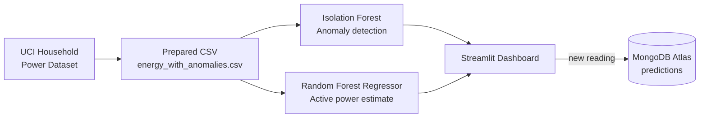

<div align="center">

# ⚡ Smart Energy Waste & Anomaly Detection System

**Spot unusual electricity consumption, estimate active power, and explore it all in an interactive dashboard.**


[Features](#-features) • [How it works](#-how-it-works) • [Dataset](#-dataset) • [Setup](#-setup) • [MongoDB Atlas](#-configure-mongodb-atlas) • [Usage](#-how-to-use) • [Models](#-model-details) • [Troubleshooting](#-troubleshooting)

</div>

---

## 📖 About

This machine-learning project analyzes household electricity readings, **flags unusual consumption patterns**, **estimates active power**, and presents everything through an interactive **Streamlit** dashboard. **MongoDB Atlas** is used (optionally) to store the prediction records you submit.

---

## ✨ Features

| | Feature | What it does |
|---|---|---|
| 📊 | **Energy overview** | Total readings, normal readings, potential anomalies and average active power |
| 📈 | **Consumption visualization** | Charts for electricity usage and normal vs. potential-anomaly counts |
| 🚨 | **Anomaly detection** | An **Isolation Forest** model flags unusual measurement patterns |
| 🔌 | **Active-power estimation** | A **Random Forest Regressor** estimates `Global_active_power` from the other electrical measurements |
| 🧪 | **Interactive testing** | Enter a new reading and instantly see the model output |
| 🍃 | **MongoDB Atlas integration** | Save and review submitted prediction records |
| 🗂️ | **Recent readings** | Browse recent rows from the prepared dataset |

---

## 🔄 How it works



---

## 🧰 Technology Stack

| Area | Tools |
|---|---|
| Language | Python |
| Data | Pandas |
| Machine learning | Scikit-learn, Joblib |
| Dashboard | Streamlit |
| Database | MongoDB Atlas, PyMongo |
| Configuration | python-dotenv |

---

## 📦 Dataset

This project uses the **Individual Household Electric Power Consumption** dataset from the UCI Machine Learning Repository.

🔗 [Dataset page](https://archive.ics.uci.edu/dataset/235/individual+household+electric+power+consumption)

**Measurements used by the models**

| Feature | Feature |
|---|---|
| `Global_active_power` | `Sub_metering_1` |
| `Global_reactive_power` | `Sub_metering_2` |
| `Voltage` | `Sub_metering_3` |
| `Global_intensity` | |

The prepared dataset must be named **`energy_with_anomalies.csv`**. Besides the measurement features, it should include a `Datetime` column and an `is_anomaly` column.

---

## 🗂️ Project Structure

Place all files in one folder:

```text
Smart-Energy-Anomaly-Detection/
├── app.py                      # Streamlit dashboard
├── energy_with_anomalies.csv   # Prepared dataset
├── anomaly_model.pkl           # Isolation Forest model
├── energy_model.pkl            # Random Forest Regressor model
├── anomaly_features.pkl        # Feature list for anomaly model
├── energy_features.pkl         # Feature list for regression model
├── requirements.txt
├── .gitignore
└── README.md
```


---

## 🚀 Setup

### 1️⃣ Install Python
Python **3.10 or 3.11** is a sensible choice for this project.

### 2️⃣ Open the project folder
Open Command Prompt or a terminal in the folder containing `app.py`.

### 3️⃣ Create and activate a virtual environment *(recommended)*

**Windows**
```bash
py -3.11 -m venv .venv
.venv\Scripts\activate
```
If Python 3.11 is not installed, use a compatible installed version.

### 4️⃣ Install dependencies
Create a `requirements.txt` containing:

```text
streamlit
pandas
scikit-learn
joblib
python-dotenv
pymongo
```

Then install:

```bash
python -m pip install -r requirements.txt
```

> ⚠️ **Note:** the saved `.pkl` models should be loaded with versions of Python and scikit-learn compatible with the ones used to train them.

---

## 🍃 Configure MongoDB Atlas

1. Create or open a **MongoDB Atlas** cluster.
2. Create a **database user** and allow network access from your current IP address.
3. Copy the **connection URI** from Atlas.
4. Create a file named `.env` in the project root.
5. Add this line, replacing the placeholders with your own values:

```env
MONGODB_URI=mongodb+srv://<username>:<password>@<cluster-address>/?retryWrites=true&w=majority
```

Do not keep the angle-bracket placeholders in a real URI. If your password contains special characters, URL-encode them as required by MongoDB.

> 🔒 **Security:** never commit `.env` or publish your database password or connection URI. If credentials are exposed, rotate them in Atlas.

The app uses the database **`smart_energy_db`** and the collection **`predictions`**. When a prediction is submitted and the connection succeeds, the app stores the input measurements, anomaly result, estimated active power and a timestamp.

---

## ▶️ Run the Application

From the project folder:

```bash
python -m streamlit run app.py
```

Streamlit prints a local URL, usually **http://localhost:8501**. Open it in your browser.

---

## 🧭 How to Use

1. Open the dashboard.
2. Review the **energy overview** and charts.
3. Scroll to **Test a New Energy Reading**.
4. Enter the seven measurement values.
5. Click **Detect Anomaly**.
6. Review the potential-anomaly result and the estimated active power.
7. If MongoDB Atlas is connected, confirm that the prediction was saved.
8. Scroll to **MongoDB Prediction Records** to inspect the saved documents in JSON-style format.

**Example of a saved MongoDB document**

```json
{
  "input_reading": {
    "Global_active_power": 0.69,
    "Global_reactive_power": 0.1,
    "Voltage": 241.0,
    "Global_intensity": 2.72,
    "Sub_metering_1": 0.0,
    "Sub_metering_2": 0.0,
    "Sub_metering_3": 1.0
  },
  "is_anomaly": 0,
  "predicted_active_power_kw": 0.604,
  "created_at": "timestamp"
}
```

*The values above are illustrative; actual stored values depend on the submitted reading and the model output. MongoDB also adds a unique `_id` to each document.*

---

## 🤖 Model Details

### 🌲 Isolation Forest — anomaly detection
An unsupervised algorithm that identifies observations that differ from learned patterns. The current configuration uses `contamination=0.02`, which guides the model to treat about **2%** of training observations as outliers.

> An anomaly is a **potential outlier**, not proof of energy waste, a faulty appliance, or an unsafe electrical condition.

### 🌳 Random Forest Regressor — active-power estimation
Estimates `Global_active_power` from the other six electrical measurements. This is an estimate based on the supplied reading, **not a forecast** of future electricity usage.

---

## 📏 Evaluation Notes

Classification metrics such as accuracy, precision, recall and F1-score need reference labels. The UCI dataset has no independently verified energy-waste or anomaly labels, so metrics compared against labels generated by another Isolation Forest are **proxy-based agreement measures**, not confirmed real-world performance.

The regression model should be evaluated on **held-out data**. Fill in the table with the actual values from your notebook before final submission:

| Metric | Value |
|---|---|
| R² score | 0.9988867484728282 |
| Mean Absolute Error (MAE) | 0.020426241063659718 |
| Root Mean Squared Error (RMSE) | 0.035230546476196396 |


---

## 🛠️ Troubleshooting

<details>
<summary><b>Unable to load project files</b></summary>

Check that the CSV and all four `.pkl` files are in the same folder as `app.py`.
</details>

<details>
<summary><b>Missing columns</b></summary>

Confirm the CSV contains `Datetime`, `is_anomaly`, and the model feature columns.
</details>

<details>
<summary><b>MongoDB is unavailable</b></summary>

Check the `.env` file, the connection URI, the Atlas network access list, the database user permissions and your internet connection. Restart Streamlit after changing `.env`.
</details>

<details>
<summary><b>Model loading / version errors</b></summary>

Use Python and scikit-learn versions compatible with the training environment.
</details>

<details>
<summary><b>Package missing</b></summary>

Run `python -m pip install -r requirements.txt` in the active environment.
</details>

---

## ⚠️ Limitations

- The dataset has **no verified labels** for energy waste or electrical faults.
- Unusual readings can reflect legitimate household activity.
- The regression model estimates active power from other measurements in the same reading; it does not forecast future demand.
- MongoDB stores submitted predictions only; it does not store the whole dataset unless additional code is added.

---

## 🔮 Future Improvements

- [ ] Add time-based electricity forecasting
- [ ] Compare readings against time-of-day and day-of-week baselines
- [ ] Validate anomalies using independently reviewed labels
- [ ] Add alerts, energy-cost estimates and downloadable reports
- [ ] Explain which measurements contributed to a flagged reading

---

## 📚 References

- [UCI Machine Learning Repository – Household Electric Power Consumption](https://archive.ics.uci.edu/dataset/235/individual+household+electric+power+consumption)
- [Scikit-learn – Isolation Forest](https://scikit-learn.org/stable/modules/generated/sklearn.ensemble.IsolationForest.html)
- [Scikit-learn – Random Forest Regressor](https://scikit-learn.org/stable/modules/generated/sklearn.ensemble.RandomForestRegressor.html)
- [Streamlit documentation](https://docs.streamlit.io/)
- [MongoDB documentation](https://www.mongodb.com/docs/)

---

<div align="center">

Made with ❤️ using Python, Streamlit and MongoDB

</div>
